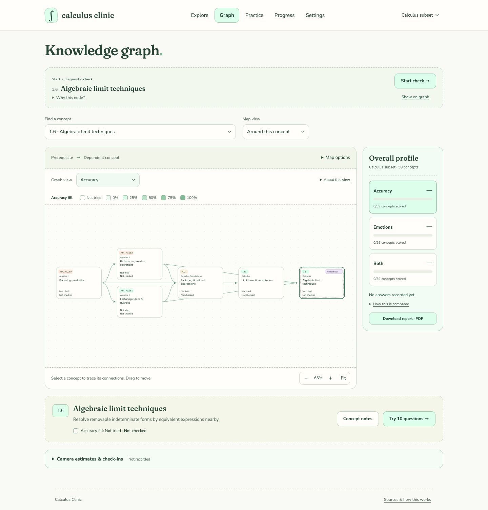
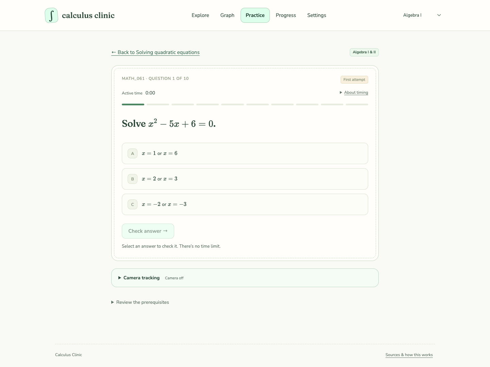
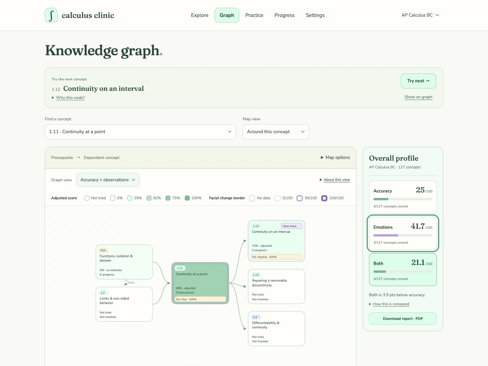
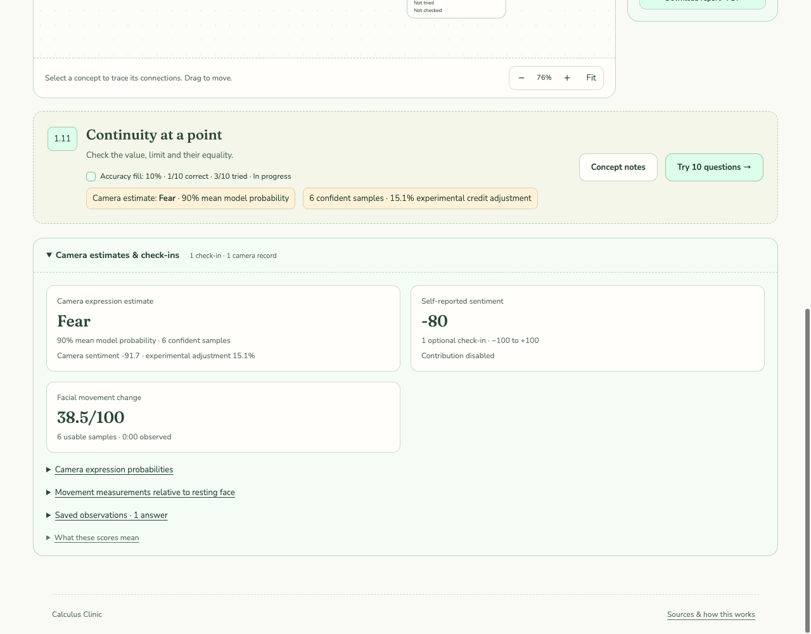
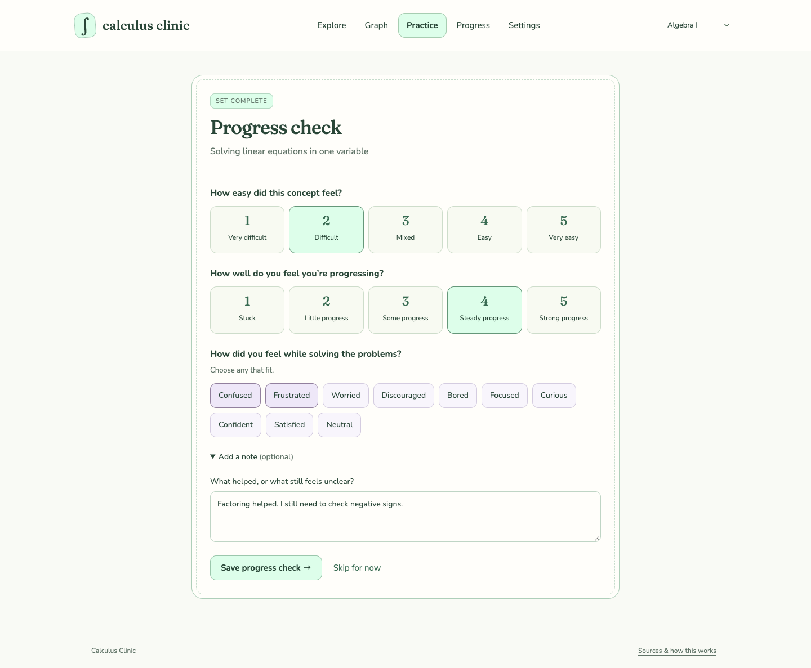

# Calculus Clinic

Calculus Clinic is a mathematics learning workspace built around knowledge graphs. It connects concepts, practice results, and observations of the learning experience so a self-learner can identify strengths, investigate gaps, and choose what to try next.

## A connected view of mathematics

Each node represents a concept group with explicit subskills, a learning objective, mathematical conditions, common misconceptions, and ten application-oriented questions. A solid arrow points **from a prerequisite to a concept that uses it**. Optional dashed edges show other mathematical relationships, such as generalization, approximation, or inverse operations.

The graph can show one concept’s neighborhood, a unit and its immediate prerequisites, or the whole selected learning path. Selecting a node connects its place in the curriculum to its notes, questions, and recorded evidence.

| Learning path | Concepts | Scope |
| --- | ---: | --- |
| Algebra I | 85 | Linear relationships, quadratics, exponential models, and foundations |
| Algebra II | 106 | Advanced functions and algebra, including Algebra I prerequisites |
| AP Calculus AB | 97 | Limits, derivatives, integrals, differential equations, and foundations |
| AP Calculus BC | 127 | AB content plus parametric and polar calculus and infinite series |
| Calculus subset | 15 | A focused Algebra I/II route into factoring-based algebraic limits |

These paths share concepts and question identities. Switching paths preserves the evidence already collected for a shared node. The Calculus subset keeps the immediate experimental focus small; broader arithmetic review remains in the full courses.

Calculus topics follow the AP AB/BC framework, and Algebra content is mapped to Texas TEKS. Prerequisite links are authored instructional judgments. They express useful dependencies without claiming that the standards prescribe a single learning sequence.



## Practice that gradually fills the graph

A diagnostic check uses ten questions for a concept. **All ten must be attempted, with at least eight latest answers correct, to pass.** Each answer receives an explanation, and questions have no deadline.

The next recommendation follows the prerequisite graph and the most recent practice evidence:

- An incomplete check resumes with its unanswered questions.
- A passed check usually leads to an unfinished dependent concept.
- A completed check below the threshold prompts a prerequisite check to investigate the gap.
- At the end of a branch, the diagnostic explores another nearby unfinished concept.

Passing a node never grants automatic credit to its prerequisites or dependents. Untested concepts remain unknown. Recommendations stay within the selected path, and learners can choose a different concept at any point.



## What the mastery displays mean

The graph offers three views of the same concepts. Darker fills indicate higher scores within the selected view; an unscored node remains visually distinct from a measured zero.

| View | Node fill | Additional context |
| --- | --- | --- |
| **Accuracy** | Latest correct answers divided by all ten questions | Question coverage and diagnostic status |
| **Accuracy + observations** | Accuracy with a bounded camera adjustment and, if enabled, a small check-in adjustment | A purple border represents facial change from the resting baseline |
| **Camera estimates only** | An experimental expression index from camera observations | Estimated expression labels and available evidence |

For the accuracy view, three correct answers with seven questions still untried fill a node to **30%**. In the answer history, that same record has **100% latest accuracy among attempted questions**. The graph includes question coverage so a small successful sample does not look like a completed check.

Only the latest answer to each question contributes to the accuracy fill. Retrying a question cannot add duplicate credit; a later incorrect answer can lower the score. First-attempt accuracy and all-attempt accuracy remain separate history measures.

The overall profile gives each scored concept equal weight. It shows the average and the number of concepts with evidence for Accuracy, Emotions, and Both. Missing camera observations are excluded from the camera average, so its coverage may differ from accuracy coverage.



*The populated screenshots use demonstration records to illustrate the displays.*

### The scoring relationship

Let **A** be accuracy as a fraction from 0 to 1. Camera observations supply:

- **N:** the combined probability of fear, sadness, and anger.
- **X:** excess facial movement occurring alongside those expression estimates, normalized from 0 to 1.
- **S:** the average unpleasant strength of optional question-level check-ins, from 0 to 1. It is zero when their contribution is disabled or no check-ins are available.

The current rules are:

```text
Camera adjustment = 0.15 × N + 0.05 × X
Combined score    = 100 × A × (1 − camera adjustment − 0.02 × S)
Camera-only score = 100 − 75 × N − 25 × X
```

Camera evidence can reduce answer credit by at most **20% of that credit**. Enabled check-ins can reduce it by at most another **2%**. For example, an accuracy fill of 80%, with N = 0.6 and X = 0.2, gives a combined score of 72% when check-ins are excluded. Without usable camera evidence or enabled check-ins, the combined score equals accuracy. The camera-only view stays unscored without sufficient camera evidence.

Happiness contributes positively to the separate sentiment summary; it does not add an accuracy bonus. **Answer correctness alone determines passing and diagnostic recommendations**, even when the combined display is lower.

### The small role of time

The active-time counter pauses when practice loses visibility or focus and during camera calibration. Submitting an answer stops it before explanation reading.

A separate time-aware practice-mastery statistic gives a correct answer full credit through two minutes, then gradually reduces that credit to 97% at five minutes. Longer responses receive the same 97%; missing time records receive neutral full credit. This adjustment is capped at three percentage points for a concept. Timing does not change the three graph views or the 8/10 pass rule.

## How facial observations are implemented

Camera observations have two distinct components: measurements of facial movement and estimates from an expression classifier. They are attached to question attempts and summarized for the relevant concept.

### Movement relative to a resting face

MediaPipe Face Landmarker supplies 17 selected facial blendshape coefficients, including inner and outer eyebrow raises, eyebrow lowering, eyelid closure and widening, jaw opening, lip compression, mouth-corner movement, and lip rounding.

After camera permission, calibration automatically collects a short resting-face sample—about six seconds, requiring at least 30 usable samples over at least five seconds. Brief detection gaps and slower processing preserve progress; unstable samples are replaced as the resting expression settles. If no steady reference is found within 45 seconds of active sampling, calibration stops and offers a manual retry. Each coefficient’s median becomes its reference value. A noise allowance accounts for ordinary variation during calibration.

For each later sample, the change score averages the absolute departures from those reference values after subtracting the noise allowance, expressed on a 0–100 scale. Signed changes are retained for individual movements, so raising and lowering a feature remain distinguishable. The graph’s purple border reflects the concept’s average movement change.

Movement magnitude alone has no positive or negative emotional meaning. For the combined score, only movement above 20/100 contributes to **X**, scaled over the remaining 80 points and weighted by the simultaneous fear/sadness/anger probability.

### Expression estimates and sentiment

The face-api expression model estimates probabilities for **neutral, happiness, sadness, anger, fear, disgust, and surprise**. Calibration personalizes the movement reference; the expression classifier itself stays fixed.

A sample contributes to the expression summary only when its leading probability is at least 55% and exceeds the next-highest probability by at least 15 percentage points. Insufficient evidence stays unscored; an ambiguous aggregate is labeled **Mixed / uncertain**. Missing faces, multiple faces, and unusable frames do not become synthetic neutral observations.

The camera sentiment summary uses:

```text
Sentiment = 100 × (P(happiness) − P(fear) − P(sadness) − P(anger))
```

Movement and expression summaries are saved with answers. Concept-level camera summaries weight each saved attempt by its usable sample count, including retries. This differs from accuracy, which uses only the latest answer per question.

These are experimental indicators for reflection. Facial expressions do not establish a person’s felt emotion or mathematical understanding. Frustration and confusion are available through voluntary reflections; they are not output classes of the camera model.



## Reflection alongside performance

Question-level emotion check-ins let learners record an emotion, its intensity, and whether it felt pleasant, neutral, or unpleasant. Their scoring contribution is **off by default**. If enabled, unpleasant intensity divided by five enters the small check-in adjustment; pleasant and neutral responses contribute zero. These check-ins never enter the camera-only score.

After a ten-question set, a separate progress survey asks about perceived ease, progress through the material, and feelings such as confusion, frustration, focus, or confidence. An optional note captures what helped or remains unclear. These end-of-set reflections do not change mastery scores or diagnostic decisions.



## Learner control and continuity

Onboarding introduces the selected path, explains the practice workflow, and requests camera permission before calibration. Camera use can be skipped or disabled in Settings. Question observations are collected during active, unanswered practice; calibration itself does not count as question evidence.

Camera processing stays on the device. Saved observations contain numeric summaries, probabilities, sample counts, and a reference identifier. The resting-face reference stays in memory for the current visit and is reused after navigating away from practice or switching tabs. Reloading, leaving the page, or revoking access clears it. Images, video, audio, and the resting-face reference itself are not saved. Learners can delete their stored practice data in Settings.

Scores are derived from saved evidence rather than maintained as independent totals. Shared concepts keep their practice history across courses, and narrowing a subset preserves earlier records. Ten-question checks sample a concept’s skills; they are not a validated measure of complete mastery.

## Where the model lives

| Responsibility | Implementation |
| --- | --- |
| Concepts, relationships, and focused subsets | [Curriculum catalog](data/catalog.mjs), [subset definitions](data/subsets.mjs) |
| Passing and next-concept recommendations | [Diagnostic rules](src/diagnostic.mjs) |
| Score weights and graph comparisons | [Scoring policy](src/score-policy.mjs), [graph views](src/graph-views.mjs) |
| Resting-face calibration and movement summaries | [Observation model](src/observations.mjs) |
| Expression probabilities, labels, and sentiment | [Expression model](src/expressions.mjs) |
| End-of-set reflections | [Progress checks](src/progress-checks.mjs) |
